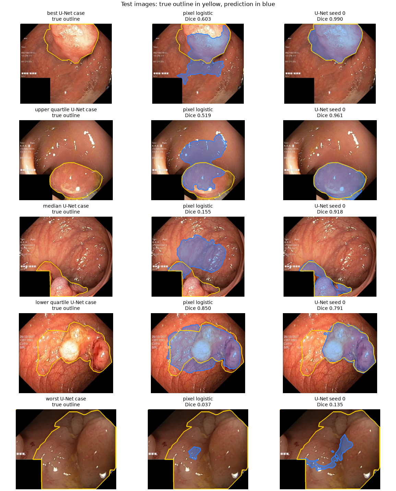

# NeuralSeg

> I measured the reference results using the original benchmark environment.

**Polyp segmentation in colonoscopy images: how far do classical methods get,
and how much does a U-Net add, scored on the same test images?**

I built classical baselines first, then a U-Net, and scored them all on the same
held-out images. A polyp is a growth on the colon wall. Kvasir-SEG is the
standard public benchmark for outlining polyps.

```text
image -> resize to 256 x 256
  -> Otsu threshold on one colour channel (chosen on train)
  |  per-pixel logistic regression on 16 colour, texture and position features
  |  U-Net (4 levels, width 32), three seeds
  -> resize back to original size -> threshold (classical: clean up the mask)
  -> Dice, IoU, precision, recall, HD95 against the true mask
```

## Setup

Python 3.12, [uv](https://docs.astral.sh/uv/), PyTorch for CUDA 12.8.

```powershell
uv sync --extra neural
uv run pytest -q --basetemp=.pytest-tmp
```

`run_study.bat` runs the tests, the download, the split, both studies and the
figure. `run_learned_study.py --reuse` skips seeds that already have a checkpoint.

## Data and split

Kvasir-SEG (Jha et al., 2020): 1000 images with polyp masks checked by doctors.
It has no patient IDs and some images are near-identical frames, so I group
images whose centre hashes differ in 40 bits or fewer and keep each group on one
side. Split: 800 train, 100 validation, 100 test (`results/split.json`).
Hashing the whole image failed: it matched the black frame every image shares.

## Metrics

Dice and IoU measure overlap (1 is perfect). HD95 is the 95th percentile of the
distance between the predicted and true outlines, in pixels. All metrics are at
original resolution, with 95% bootstrap intervals over the test images.

## Results

100 test images. HD95 is the median over images.

| Method | Dice (95% CI) | IoU | Precision | Recall | HD95 (px) |
|---|---|---|---|---|---|
| Otsu, Lab lightness | 0.357 (0.311 to 0.402) | 0.250 | 0.257 | 0.973 | 271.6 |
| Pixel logistic | 0.482 (0.435 to 0.526) | 0.349 | 0.459 | 0.739 | 167.3 |
| U-Net, seed 0 | 0.841 (0.802 to 0.875) | 0.761 | 0.888 | 0.857 | 40.5 |
| U-Net, seed 1 | 0.851 (0.813 to 0.882) | 0.770 | 0.905 | 0.849 | 38.9 |
| U-Net, seed 2 | 0.840 (0.802 to 0.872) | 0.757 | 0.867 | 0.872 | 46.4 |
| U-Net, mean of seeds | 0.844 (0.808 to 0.874) | 0.763 | 0.887 | 0.859 | 53.4 |

- The U-Net beats the pixel logistic model by 0.362 Dice (95% CI 0.315 to
  0.411) and scores higher on 94 of the 100 images.
- The classical methods fail because polyps are almost the same colour as the
  wall. Otsu catches the polyp (recall 0.973) but also most of the wall
  (precision 0.257).
- The three seeds agree (Dice 0.840 to 0.851). Between 4 and 8 images per seed
  still score below 0.5.



Five test images ranked by U-Net Dice, best to worst (true outline yellow,
prediction blue). The logistic model marks wall that looks like polyp. The
U-Net's worst case is a polyp that fills almost the whole frame.

Each seed trained for about 40 minutes on an RTX 3050 Laptop GPU. Per-image
scores are in `results/*/test_cases.csv`.

## Limits and next steps

- The hash only catches near-identical frames, so scores may be a little
  optimistic.
- Next: a pretrained encoder, and testing on a second dataset (CVC-ClinicDB).

## References

- D. Jha et al. "Kvasir-SEG: A Segmented Polyp Dataset." MMM 2020.
  https://datasets.simula.no/kvasir-seg/
- O. Ronneberger, P. Fischer, T. Brox. "U-Net: Convolutional Networks for
  Biomedical Image Segmentation." MICCAI 2015.
